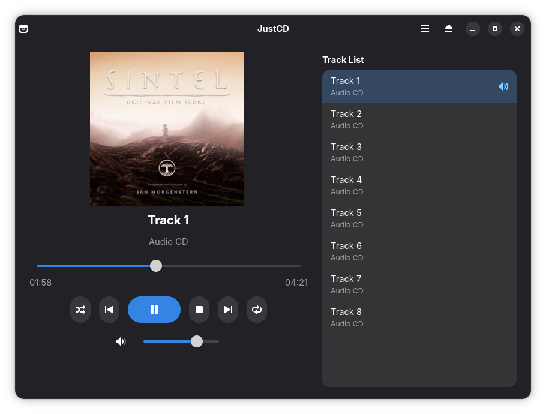

# JustCD

A sleek, minimalist audio compact disc (CD-DA) player for the GNOME desktop on Linux.



JustCD is focused on simplicity and the traditional experience of physical audio media. It integrates with modern GNOME design patterns (Libadwaita) without unnecessary configuration layers or complex menus.

## Features

* **Audio Playback:** Direct hardware-based playback powered by GStreamer and libcdio.
* **Online Metadata:** Automatic retrieval of album art and track titles via MusicBrainz and the Cover Art Archive.
* **Hardware Integration:** Synchronized tray state and physical ejection detection using UDisks2 and Linux kernel ioctl calls.
* **Offline Fallback:** Continues playback with local track numbering when an internet connection is unavailable.
* **Multilingual:** Fully localized with support for multiple languages, including English, Spanish, Catalan, Galician, Basque, Portuguese (Portugal & Brazil), French, German, Italian, Russian, Japanese, and Simplified Chinese.
* **User Interface:**
  * Two-column layout separating the player from the tracklist.
  * Dynamic cover art scaling between normal and maximized window states.
  * Individual track duration indicators.
  * Active track status highlighting.
* **Playback Modes:**
  * Shuffle and Repeat modes (Off, Full Disc, Single Track) with mutually exclusive logic.
  * Volume control with quick mute toggle.
  * Three-second replay behavior on the Previous track control.
* **Desktop Integration:**
  * MPRIS2 D-Bus interface support for system media keys and shell controls.
  * Integrated GNOME Shortcuts overlay window.
  * Preferences dialog with persistent local storage.

## Requirements

The application runs inside a Flatpak container using the GNOME 47 runtime.

On Fedora, ensure Flatpak and flatpak-builder are available:

```bash
sudo dnf install flatpak flatpak-builder
flatpak install flathub org.gnome.Platform//47 org.gnome.Sdk//47
```

## Building and Installation

Clone the repository and build the Flatpak package locally:

```bash
git clone https://github.com/marcopcabrera/JustCD.git
cd JustCD
flatpak-builder --user --install --force-clean build-dir io.github.marcopcabrera.JustCD.json
```

To run the application:

```bash
flatpak run io.github.marcopcabrera.JustCD
```

## Keyboard Shortcuts

| Key | Action |
| :--- | :--- |
| Space | Play / Pause |
| Ctrl + Right | Next track |
| Ctrl + Left | Previous track |
| Right | Seek forward 5 seconds |
| Left | Seek backward 5 seconds |
| Ctrl + E | Eject or close disc tray |
| Ctrl + M | Toggle mute |
| Ctrl + , | Open Preferences |
| Ctrl + ? or F1 | Show keyboard shortcuts |

## License

This project is free software licensed under the GNU General Public License version 3 (GPL-3.0). See the [LICENSE](LICENSE) file for the full license text.

Author: Marco P. Cabrera
